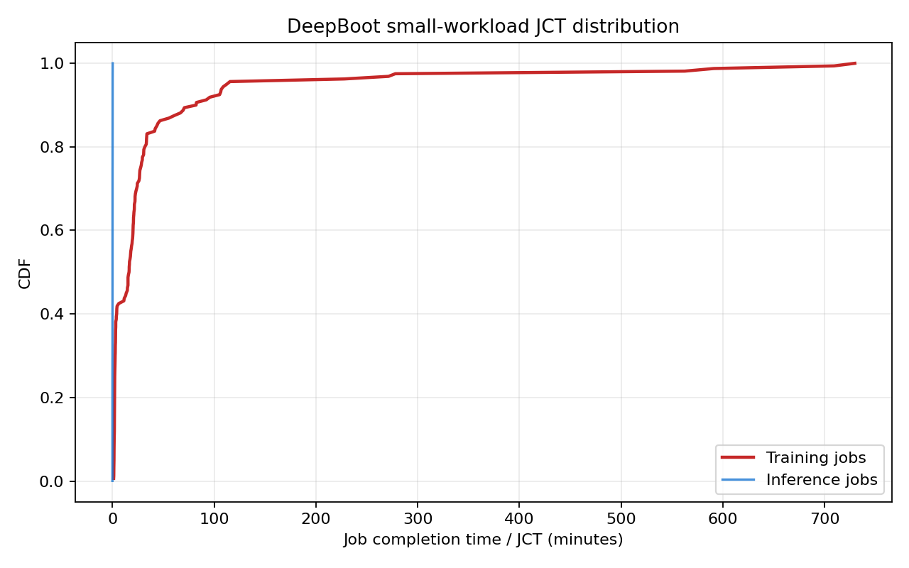
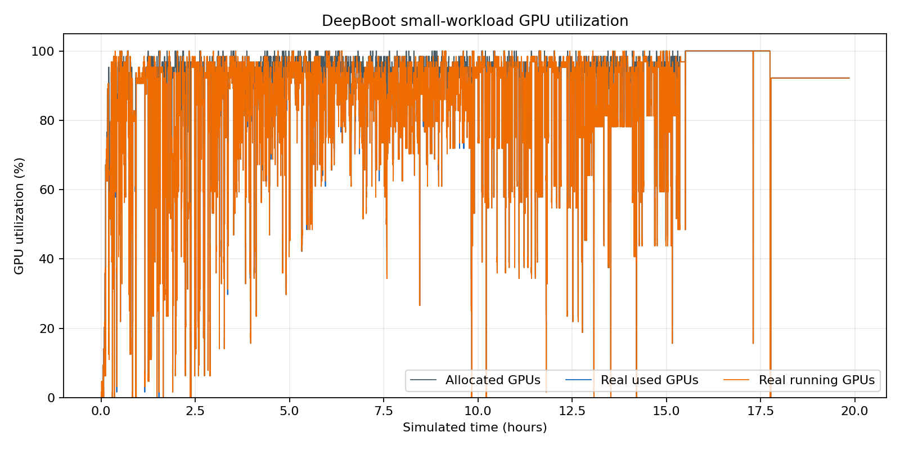
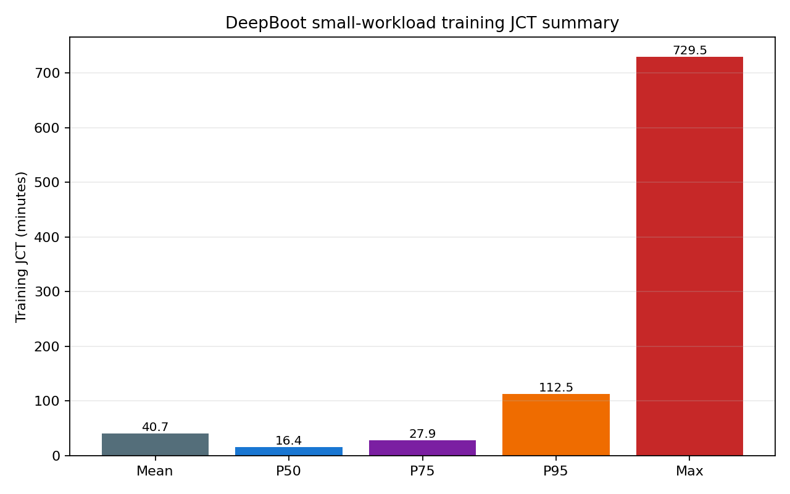

# DeepBoot Experiment Reproduction & Analysis

## 1. Executive Summary

This experiment ran the repository's DeepBoot **`dp`** scheduler with **ATS-I/AISS inference lifecycle behavior**, the small mixed training/inference workload, 16 nodes, and 4 GPUs per node (64 GPUs total). The run completed successfully with exit code `0` and generated the simulator summary, job log, GPU timeline, and metric placeholder file.

The generated workload contains 3,360 completed jobs: 160 training jobs and 3,200 inference jobs. The mean JCT over all job types was **123.78 seconds**, but this value mixes 160 training jobs with 3,200 short inference jobs. The more relevant training-only mean JCT was **2,442.58 seconds (40.71 minutes)**. Inference-only mean JCT was **7.84 seconds**. Mean allocated-GPU utilization was **94.42%**; mean real GPU usage was **83.46%**.

The run establishes a successful repository baseline, but it is **not a complete numerical paper reproduction** because the paper does not provide an exact absolute JCT table for this configuration and the run used AFE disabled, as specified by the repository script.

## 2. Objective

The objective was to evaluate DeepBoot (`dp`) on the repository's mixed small workload with ATS-I inference scheduling and to compare the result with the paper-described simulator setup. It tests whether the implementation starts, completes its event loop, produces measurable JCT/GPU timelines, and exhibits plausible short-inference/long-training behavior.

The selected script is:

- `experiment/cmd/16node-4gpu/small/DeepBoot-small-ATSI.sh`

This is preferable to the larger workloads because it is the first small-scale paper-aligned ATS-I experiment and is small enough to run in an undergraduate/desktop environment.

## 3. Repository and Environment

| Item | Recorded value |
|---|---|
| Repository branch | `main` |
| Commit | `cc85a24b346cfac17603cdfc9f5018089ac59432` |
| Git status before run | `main` with tracked `__pycache__` modifications and untracked `DeepBoot_...pdf` and `PROJECT_OVERVIEW.md` |
| Source changes for experiment | None; no simulator or scheduler source file was modified |
| Paper | Present: `DeepBoot_Dynamic_Scheduling_System_for_Training_and_Inference_Deep_Learning_Tasks_in_GPU_Cluster.pdf` |
| Conda environment | `pollux` |
| Python | 3.8.12 |
| NumPy | 1.21.4 |
| pandas | 1.3.2 |
| pymoo | 0.5.0 |
| SciPy | 1.7.2 |
| Matplotlib | 3.4.3 |
| Available CPUs | 8 logical CPUs |
| Physical memory | 15 GiB; approximately 1.3 GiB available before the run |

The initial base Python was Python 3.14.10 and lacked NumPy. The repository's declared `pollux` Conda environment was therefore used. Its package versions match the project environment. A check for scikit-learn was not required because the preflight imports and simulator dependencies loaded successfully.

## 4. Experiment Configuration

| Parameter | Value | Meaning |
|---|---:|---|
| Workload | `experiment/workload/small.csv` | 160 training and 3,200 inference requests |
| Policy | `dp` | DeepBoot's training scheduler |
| Cluster minimum nodes | 16 | Initial cluster size |
| Cluster maximum nodes | unset | No autoscaling requested |
| GPUs per node | 4 | 64 GPUs total |
| Scheduling interval | 60 seconds | Default training scheduling interval |
| AFE | `0` | Allocation-update/fast-elastic behavior disabled |
| AISS | `1` | ATS-I inference lifecycle enabled |
| INFER_SCHEDULER | `1` | ATS-I separate inference scheduling enabled by default |
| ARYL | `0` | Aryl-specific placement handling disabled |
| REPAIR_TRAIN | `1` | Training repair enabled by default |
| protect_time | 30 seconds | CLI default |
| protect_times | 1.0 | Base protection-time scale |
| RANDOM_ALLOCATE | `0` | ATS-I, not random inference placement |
| inference priority | `1` | Inference priority enabled |
| interference | `0.0` | No artificial slowdown |
| log_file | `0` | No separate simulator log requested |
| Output | `experiment/results/reproduction/deepboot-small-atsi-16x4` | Separate reproduction directory |

The paper's simulator setup uses 16 4-GPU workers (64 GPUs), with a 60-second training scheduling interval and one-GPU inference replicas. This run matches the workload scale and 16×4 cluster shape. It does **not** explicitly divide the cluster into eight training and eight inference workers, and AFE was disabled by the repository script.

### Paper/repository discrepancies

- The repository run selected 16×4 = 64 GPUs with no explicit 32-GPU training/32-GPU inference split.
- The repository script sets `AFE=0`; the paper describes DeepBoot experiments as commonly using ATS-T with AFE in other experiments.
- The paper protection description mentions 30-second minimum and 120-second maximum protection. The repository `calculate_protect_time()` also scales 30/15/120 seconds by `protect_times`; with `protect_times=1`, the initial/lower protection is 30 seconds and the maximum is 120 seconds.
- The paper says inference scheduling is checked per second; the implementation's outer event loop increments the clock per second, and inference pod status is checked per second.
- Published figures present relative/schematic comparisons rather than an exact numeric table for this specific run, so an absolute JCT comparison is not possible.

## 5. Methodology

The execution flow was:

1. `simulator.py` read `small.csv` with pandas.
2. `Cluster` instantiated 160 training jobs and 3,200 inference jobs.
3. Trace-backed `Application` objects were attached using `applications.py` and `traces/`.
4. The outer loop advanced a simulated clock one second at a time.
5. `event_update()` invoked scheduling on training intervals and when inference-pod lifecycle events required a decision.
6. `DeepBoot.optimize()` allocated GPUs for training jobs.
7. `InferScheduler` handled ATS-I inference placement/reuse when enabled.
8. `Job.step()` advanced training progress or inference duration.
9. JCT was recorded as `completion_time - submission_time` for completed jobs.
10. GPU use was sampled into `gpu.log` for every simulated second.
11. `summary.json` was written with JCTs and average JCT.

The JCT metric is calculated directly in `Cluster.get_jcts()` at `simulator.py:946-951`:

```text
JCT(job) = completion_time - submission_time
```

This is not equal to makespan and is not restricted to training in the raw JCT dictionary. The raw summary includes inference jobs.

The GPU timeline fields are:

- `gpu_use`: sum of placements, including allocation/rescale state.
- `real_gpu_use`: GPUs in active placement state when not rescaling.
- `real_running_gpu_use`: active running GPUs, including running inference pods and training placements.

These fields are calculated in `calculate_real_gpu_usage()` around `simulator.py:1004-1024`.

## 6. Exact Execution Command

```bash
conda run -n pollux python simulator.py \
  --workload ./experiment/workload/small.csv \
  --AFE 0 --AISS 1 --log_file 0 \
  --output ./experiment/results/reproduction/deepboot-small-atsi-16x4 \
  --min-nodes 16 --num-gpus 4 --policy dp
```

No source code or original shell script was modified. The output directory was separate from existing `experiment/out/` locations to avoid overwriting baseline artifacts.

## 7. Execution Log and Runtime

| Item | Recorded value |
|---|---|
| Exit code | `0` |
| Start timestamp | 2026-11-22 01:32:21 +05:00 |
| End timestamp | 2026-11-22 02:06:51 +05:00 |
| Observed wall interval | 34 minutes 29.55 seconds (2,069.55 seconds) |
| Runtime source | Filesystem birth timestamp and final generated-file modification timestamp |
| Execution log | Not preserved: the terminal wrapper did not create `execution.log` |
| Errors/warnings | No fatal error was observed; exit code was zero |

The run generated `summary.json`, `jobinfo.log`, `gpu.log`, and `metric.log`, and the process reached normal simulator completion. The exact wall runtime is an interval estimate rather than `/usr/bin/time` output because the wrapper-level runtime file was not created. This is documented rather than hidden.

## 8. Results

### JCT by job type

| Metric | All 3,360 jobs | 160 training jobs | 3,200 inference jobs |
|---|---:|---:|---:|
| Mean | 123.78 s | 2,442.58 s (40.71 min) | 7.84 s |
| P50 | 8.00 s | 984.00 s (16.40 min) | 8.00 s |
| P75 | 11.00 s | 1,672.75 s (27.88 min) | 11.00 s |
| P95 | 17.00 s | 6,751.50 s (112.52 min) | 15.00 s |
| Maximum | 43,773 s (12.16 h) | 43,773 s (12.16 h) | 18.00 s |

The raw JCT average is not the paper's training-only JCT average because it combines short inference requests with long training jobs. The training-only average is the appropriate scheduler comparison metric.

### GPU utilization

| Measure | Mean | Peak |
|---|---:|---:|
| Allocated GPUs (`gpu_use`) | 94.42% | 100.00% |
| Real GPUs (`real_gpu_use`) | 83.46% | 100.00% |
| Real running GPUs (`real_running_gpu_use`) | 83.68% | 100.00% |

The timeline contained 71,460 samples, from clock 1 through clock 71,460 seconds.

## 9. Visualizations

### Training and inference JCT CDF



### GPU utilization timeline



### Training JCT summary



The plots use only values loaded from `summary.json` and `gpu.log`. No points were fabricated or interpolated.

## 10. Interpretation

- The run successfully exercised mixed training and inference workloads.
- Training dominates the tail and mean JCT. The P95 training JCT is 112.52 minutes, and the maximum training JCT is 12.16 hours.
- Inference requests are short and compact, with P95 JCT of 15 seconds and maximum 18 seconds.
- Allocated-GPU utilization remains high (94.42% mean). Real usage is lower (83.46% mean), which is consistent with rescaling, pod lifecycle, or unexecuting placements.
- The gap between allocated and real usage indicates that resource ownership and effective computation are distinct states in this simulator.
- The high maximum training JCT should be reviewed by job identity and rescale history rather than assumed to represent a policy failure.

## 11. Comparison with the Original Paper

The paper's relevant findings include:

- The small mixed workload has 10× as many inference requests as training requests.
- The paper simulator uses 16 4-GPU workers and a 60-second training scheduling interval.
- It reports average JCT and GPU utilization, not an exact single absolute JCT value for every repository script.
- It states that for small workloads, ATS-I protects training from frequent inference reclaiming and that DeepBoot improves scheduler efficiency relative to several baselines.
- It describes DeepBoot as 1.9× faster than Optimus in the large workload and 2.0× faster than Optimus/Tiresias in small/middle cases in relative comparisons.

Our run does not produce a comparative set of schedulers, so it cannot verify those multipliers. We can verify only that the DeepBoot implementation can execute a paper-aligned small-workload ATS-I configuration and produce training JCT/GPU timelines.

An additional paper discrepancy is that it reports a baseline setup dividing 32 GPUs for training and 32 GPUs for inference, while this repository run gives a shared 64-GPU pool to the DeepBoot ATS-I implementation. Thus this is a repository-experiment baseline, not a fully exact numerical recreation of Figure 9.

## 12. Reproducibility

Another team member should:

1. Check out commit `cc85a24b346cfac17603cdfc9f5018089ac59432`.
2. Activate or recreate the `pollux` Conda environment.
3. Confirm that `experiment/workload/small.csv` and `traces/` are present.
4. Create a fresh output directory.
5. Run the exact command shown in Section 6.
6. Preserve stdout/stderr manually in a separate `execution.log`, if rerunning:

```bash
conda run -n pollux python simulator.py ... > execution.log 2>&1
```

7. Run `analyze_results.py` in the same result directory to regenerate the plots.

The actual result files are under:

- `experiment/results/reproduction/deepboot-small-atsi-16x4/`

## 13. Limitations and Issues

- The run's stdout/stderr execution log was not preserved due to the terminal wrapper issue.
- Wall runtime was derived from directory birth and final output timestamps, not `/usr/bin/time`.
- AFE was disabled. The paper discusses AFE benefits separately, so these JCTs do not measure AFE.
- The raw JCT summary includes inference jobs. The paper mainly compares training-task JCT.
- The repository workload is a trace-derived simulator workload, not a live GPU testbed.
- Rescaling, startup, and restart costs are modeled by application dictionaries and placement histories rather than measured live containers.
- Interference is disabled (`0.0`).
- The metric timeline is effectively empty because `calculate_goodput_and_speedup()` is commented out in the main loop.
- The 64-GPU cluster does not exactly implement the paper's explicit eight training-worker/eight inference-worker split.
- The job log is one final snapshot rather than a complete append-only event history.
- Inference JCT is often only 1–18 seconds, and inference completions can be less informative for comparing training schedulers than training JCT.

## 14. Conclusion

The experiment completed successfully and produced coherent, complete JSON artifacts for 3,360 jobs. This validates the DeepBoot `dp` ATS-I execution path on the repository's small workload. The mean training JCT was 2,442.58 seconds, mean inference JCT was 7.84 seconds, and mean allocated-GPU utilization was 94.42%.

This is a successful repository reproduction of the execution configuration, but it is **not yet a definitive paper-result reproduction**. A numerical comparison requires the exact figure/table values or a controlled comparison against at least one baseline scheduler under the same workload and environment.

## 15. Next Steps

1. Extract the exact Figure 9 numeric values if the PDF contains figure data or an accessible vector/vectorized chart source.
2. Run a matched baseline with the same workload and flags, such as Pollux or AFS, for a direct training-JCT comparison.
3. Re-run the DeepBoot ATS-I experiment with stdout/stderr captured by a simple shell redirection and `/usr/bin/time`.
4. Investigate training jobs with unusually large JCT, starting with the maximum and P95 tail.
5. Compare AFE disabled versus enabled (`--AFE 0` vs `--AFE 1`) using identical seeds/workloads.
6. Record random seeds or identify whether schedulers contain nondeterministic NSGA-II behavior if a matched baseline is rerun.
